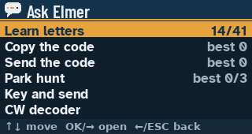
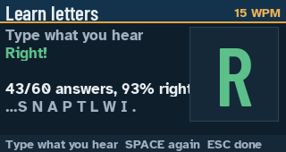
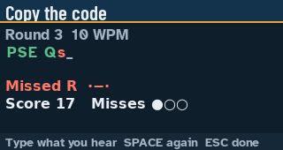
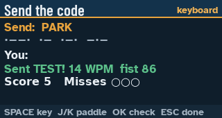
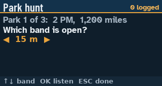
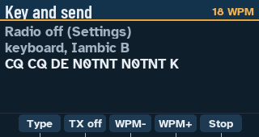

# Ask Elmer Morse

Learn Morse code and use it on the air, on the M5Stack CardputerZero. From
[Ask Elmer](https://askelmer.com): the same Koch order, practice text and
cheers as the Morse games on askelmer.com.

| | |
|---|---|
|  |  |
|  |  |
|  |  |

## What it does

- **Learn letters**: the Koch method. You start with K and M; each new
  character is played to you before you're tested on it. The next one
  unlocks when your last 60 answers are 90% right, the newest character has
  15 tries at 85%, and no character is "in trouble".
- **Copy the code**: messages built only from what you've learned, a little
  faster each round (Farnsworth spacing). Three misses and the band closes.
- **Send the code**: key the word shown. Your speed and a fist score (dah:dit
  ratio, steadiness, spacing) come back for each word.
- **Park hunt**: pick the band that's open for the clue's time and distance,
  then copy a park activator's call and exchange through static, fading and
  another station.
- **Key and send**: an iambic A/B or straight-key keyer with sidetone, and
  everything you send decoded on screen. Type a message to send it at the
  keyer speed. With a radio set up, key 5 turns transmit on.
- **CW decoder**: decodes CW from radio audio, finding the tone and speed on
  its own. Also from the command line: `askelmer-morse --decode-audio`.

## Keys

- Typing screens: type what you hear, SPACE plays it again, ESC leaves.
- Keying screens: SPACE is a straight key, J and K are dit and dah paddles,
  and a real paddle on the GPIO pins always works.
- Key and send: 4 type a message, 5 transmit on/off, 6/7 keyer speed, 8 stop.
- Fn+H shows help on any screen.

## Paddle, radio and audio

See [hardware/README.md](hardware/README.md) for wiring, the optocoupler
key-out and the clip-on box. In short:

- **Paddle**: 3.5 mm stereo jack to the EXT header: tip (dit) GPIO22 pin 5,
  ring (dah) GPIO26 pin 1, sleeve GND pin 4. The app turns on the pull-ups.
- **Key-out**: GPIO23 (pin 3) drives a PC817 optocoupler that closes the
  radio's key line. The radio and the Cardputer never share a wire.
- **QRP Labs QMX over USB**: one cable. Typed text goes out with the CAT
  `KY` command; the paddle keys the QMX's keyer on DTR (set the CW keyer to
  DTR in the QMX's USB/CAT settings). The decoder can read the QMX's USB
  audio.
- **Transmit safety**: transmit is off every time the app starts, needs a
  confirmation to turn on, and lets go of a key held over 10 seconds.

## Building

    python3 -m pytest tests
    scripts/build_deb.sh          # build/askelmer-morse_0.1.0-1_arm64.deb
    python3 -m elmermorse --screens screenshots

Runs as the normal user (gpio and dialout groups for the paddle and a USB
rig). Settings and progress: `~/.config/askelmer-morse/state.json`.
