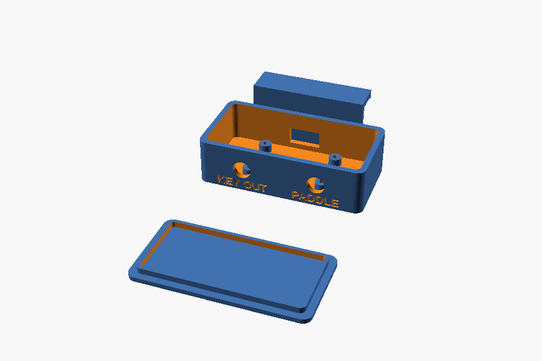

# Ask Elmer key box: paddle in, key out

A small box that clips to the CardputerZero and connects by a short lead to
its EXT header. It has two 3.5 mm jacks:

- **PADDLE**: plug in an iambic paddle (stereo plug) or a straight key (mono
  plug).
- **KEY OUT**: a cable from here to the radio's key jack. The radio is keyed
  by an optocoupler, so the radio and the Cardputer never share a wire.

With a QRP Labs QMX you don't need KEY OUT at all: one USB cable does text
sending (CAT `KY`), live keying (DTR) and the decoder audio. See the app's
README.

## Schematic

```
 CardputerZero EXT header                    PADDLE jack (3.5 mm stereo)
 ------------------------                    ---------------------------
 pin 5  GPIO22 ---------------------------- tip     (dit)
 pin 1  GPIO26 ---------------------------- ring    (dah)
 pin 4  GND    ---------------------------- sleeve  (common)
        (the app turns on the internal pull-ups: no resistors needed)

                                             KEY OUT jack (3.5 mm)
                                             ---------------------
 pin 3  GPIO23 ---[ R1 330 ]---+            +---- tip    (radio key line)
                               |            |
                          1 (A)|  PC817   4 (C)
                               |   U1       |
                          2 (K)|          3 (E)
                               |            |
 pin 4  GND    ----------------+            +---- sleeve (radio ground)
                                             ring: not connected

 Optional: D1 (1N4148) across pins 4-3 of U1, cathode to pin 4, if the
 radio's key line is long or noisy. Most radios key with under 1 mA at
 5 V or less, well inside the PC817's 50 mA / 80 V ratings.
```

GPIO23 high = LED on = transistor on = key down. 3.3 V through 330 ohm
gives about 6 mA through the LED, plenty for the PC817 (current transfer
ratio 50% or more) to sink a radio's key line. The key line polarity
matters: tip (collector, pin 4) to the radio's key, sleeve (emitter, pin 3)
to its ground. If the radio doesn't key, the plug is probably reversed
(a few radios want positive keying with the ring; check the manual).

The app keeps GPIO23 low unless **Key and send** is open with **Radio:
GPIO key-out** set, and only keys it after you turn transmit on and confirm.
A key held over 10 seconds is let go.

## Parts

| Ref | Part | Notes |
|---|---|---|
| J1 | 3.5 mm stereo panel jack (PJ-392, Switchcraft 35RAPC or similar) | PADDLE |
| J2 | 3.5 mm stereo panel jack | KEY OUT (ring unused, so stereo or mono cables both work) |
| U1 | PC817 optocoupler, DIP-4 | or 4N25 / 4N35 (pins differ, check) |
| R1 | 330 ohm, 1/4 W | |
| D1 | 1N4148 (optional) | |
| - | Perfboard, 5 x 7 holes or so (about 30 x 20 mm) | on four M2 screws |
| - | 2 x 7 female header and 10 cm ribbon, or 4 Dupont jumpers | to the EXT header: pins 1, 3, 4, 5 |
| - | 4 x M2 x 5 self-tapping screws | PCB |
| - | Printed body and lid | `elmer_key_box_body.stl`, `elmer_key_box_lid.stl` |
| - | 3.5 mm stereo cable | to the radio's key jack |

Everything is under about USD 5 in parts.

## Printing

`elmer_key_box.scad` is parametric. **Measure your CardputerZero first**
and set `device_t` to its thickness where the clip grips; the clip is a
U-shaped spring that slides over the edge, so check it won't cover a port.
The STL files here use `device_t = 19.5`.

- PETG (springier clip) or PLA, 0.2 mm layers, 3 walls, 20% infill.
- Body: print opening up, no supports. Lid: print flat, mark down.
- Jack holes are 6.2 mm for the usual M6 threaded bush; adjust `jack_d`.



## Other wiring

- **Straight key**: any mono plug in PADDLE (tip to sleeve) works in any
  mode; set **Paddle: Straight key** in Settings for straight-key timing.
- **Swap paddles**: if dit and dah come out backwards, set **Swap paddles**.
- **Decoder audio**: the radio's headphone or line out into the side jack's
  mic ring with a TRRS plug (CTIA: tip L, ring 1 R, ring 2 ground, sleeve
  mic). Put a 10:1 divider (10k series, 1k to ground) in line so a loud
  radio doesn't overload the mic input. A USB sound card avoids all that.
